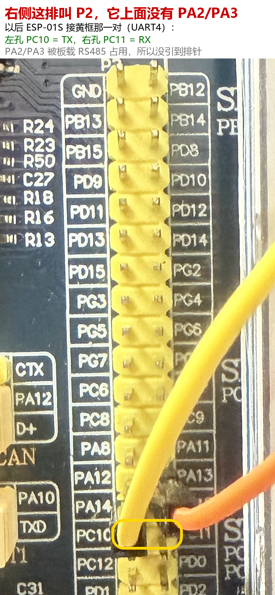

# STM32 多协议工业数据采集网关

基于 **STM32F103ZET6 + FreeRTOS** 的边缘网关示例：作为 Modbus RTU 主站轮询现场从站，同时采集本地温度与振动，
通过 ESP-01S（AT 指令）以 MQTT 上报云端，并接收一条远程 LED 控制命令。

项目规模不大，但把「现场总线采集 → 本地闭环 → 无线上云 → 远程控制」这条链路完整跑通了，
适合作为 STM32 + RTOS + 物联网的入门参考工程。

| 项目 | 说明 |
|---|---|
| 主控 | 正点原子 精英 STM32F103ZET6（72 MHz，512 KB Flash / 64 KB RAM） |
| RTOS | FreeRTOS 10.x，8 个任务，heap_4，16 KB 堆 |
| 工具链 | Keil MDK（ARMCC v5.06），可直接打开 `firmware/Projects/MDK-ARM/atk_f103.uvprojx` |
| 无 RTOS 依赖 | 全部应用代码在 `firmware/User/`，HAL 只用到 GPIO / USART / FSMC / CAN |

## 功能

| 功能 | 说明 |
|---|---|
| Modbus RTU 主站 | USART3 @9600，0x03 读从站 1 的 3 个保持寄存器（温度 / 湿度 / 状态） |
| 本地温度 | DS18B20 单总线，12 位分辨率，带 CRC8 校验 |
| 振动检测 | MPU6050 三轴加速度合成模长减 1 g，换算为 mg |
| 本地报警 | 温度 ≥ 30.0 ℃ 点亮 LED1，完全不依赖网络 |
| 云端上报 | MQTT 3.1.1，QoS1，每 5 s 一条 JSON |
| 远程控制 | 订阅命令主题，`{"led":1}` 常亮 / `{"led":0}` 恢复心跳闪烁 |
| 断线自恢复 | TCP 断开或连续 3 条 PUBLISH 收不到 PUBACK 时自动重连 |
| 本地显示 | 2.8 寸 FSMC TFT 实时显示温度 / 湿度 / 振动 / 链路状态 / 在线时长 |
| 运行监控 | 串口每 5 s 打印剩余堆和任务栈水位 |
| CAN 自测 | bxCAN 500 kbps 回环收发（PA11/PA12 + TJA1050），每 2 s 打印一帧收发结果 |

## 系统结构

```text
                 ┌─────────────── FreeRTOS ───────────────┐
 Modbus 从站 ──USART3(9600)──▶ task_modbus ─┐              │
 DS18B20 ──PA1──▶             task_modbus ─┤              │
 MPU6050 ──PB6/PB7(I2C)──▶    task_i2c    ─┼─▶ gateway_state_t
                                            │      ▲ 互斥锁
 ESP-01S ──UART4(115200)──▶   task_esp    ─┘      │ 快照
 LED0/LED1 ◀────────────────  task_led    ◀───────┤
 LCD(FSMC) ◀────────────────  task_lcd    ◀───────┘

 MQTT  topic  stm32/gw01/telemetry  (上行)
              stm32/gw01/cmd        (下行)
```

全系统只有一份「当前状态」`gateway_state_t`，由互斥锁保护。需要数据的任务调用
`gateway_state_snapshot()` 取一份完整副本，避免读到「改了一半」的结构体，也避免长时间占锁。

## 硬件

| 器件 | 型号 / 说明 |
|---|---|
| 主控板 | 正点原子 精英 STM32F103ZET6 开发板 |
| 显示屏 | 正点原子 2.8 寸 TFT，FSMC 接口（ST7789，上电读到 LCD ID = 0x7789） |
| Wi-Fi | ESP-01S，出厂 AT 固件，3.3 V 供电 |
| 温度 | DS18B20（TO-92 或带板模块，带板上拉电阻） |
| 姿态 | MPU6050 模块（I2C，地址 0x68） |
| 串口 | CH340 USB 转 TTL ×2：一路调试，一路接 Modbus |
| 电源 | ESP-01S 建议单独 3.3 V 供电，并与开发板共地 |

## 接线

| 功能 | 引脚 | 参数 / 注意 |
|---|---|---|
| 调试串口 | USART1：PA9(TX) / PA10(RX) | 115200 8N1 |
| Modbus 总线 | USART3：PB10(TX) / PB11(RX) | 9600 8N1，接 USB-TTL |
| ESP-01S | UART4：PC10(TX) / PC11(RX) | 115200 8N1，**必须共地**，EN 接 3.3 V |
| DS18B20 | PA1（DQ） | 裸管需 4.7 kΩ 上拉到 3.3 V |
| MPU6050 | PB6(SCL) / PB7(SDA) | 软件 I2C，约 125 kHz |
| LED0 | PB5 | 低电平点亮，心跳 500 ms，可被远程改为常亮 |
| LED1 | PE5 | 低电平点亮，报警灯 |
| KEY1 | PE3 | 按下在串口打印一次计数 |
| LCD | FSMC 排线 | 原厂排线，不需要改动 |

PC10 / PC11 位于开发板 P2 排针，位置见下图：



注意事项：

1. ESP-01S 与开发板必须共地，否则 AT 指令时好时坏。
2. ESP-01S 的 EN 脚接 3.3 V，否则模块不工作。
3. 开发板 3.3 V 只带一路 ESP-01S 时容易在发射瞬间掉压重启，建议独立供电。
4. Modbus 那路 USB-TTL 只接 PB10 / PB11 / GND，不要再把它的 3.3 V 接到开发板，两路电源会打架。

## 目录结构

```text
.
├─ firmware/                     Keil MDK 工程（ARMCC v5.06）
│  ├─ User/                      应用代码
│  │  ├─ app_rtos.c[.h]          任务创建、MQTT 报文、ESP 状态机
│  │  ├─ gateway_state.c[.h]     共享状态 + 互斥锁 + 报警判定
│  │  ├─ modbus_rtu.c[.h]        Modbus RTU 主站 + CRC16
│  │  ├─ esp_at.c[.h]            UART4 驱动：中断接收 + 环形缓冲
│  │  ├─ i2c_bsp.c[.h]           软件 I2C + 总线扫描
│  │  ├─ ds18b20.c[.h]           单总线时序 + CRC8
│  │  ├─ can_bsp.c[.h]           bxCAN 初始化与收发（回环自测）
│  │  └─ main.c / stm32f1xx_it.c 初始化与中断
│  ├─ Drivers/                   CMSIS、HAL、BSP（正点原子 LCD/LED/KEY 驱动）
│  ├─ Middlewares/               FreeRTOS 内核与 heap_4
│  └─ Projects/MDK-ARM/          atk_f103.uvprojx
├─ tools/                        电脑端辅助工具（不参与固件编译）
│  ├─ modbus_slave_sim.py        Modbus RTU 从站模拟器
│  ├─ mqtt_dashboard.html        网页监视面板，可远程点亮 LED0
│  └─ selftest.py                Modbus 示例帧 CRC 自检
└─ docs/                         硬件、架构、开发记录、验收
```

## 快速开始

### 1. 修改主题与客户端 ID（重要）

默认使用公共 Broker `broker.emqx.io`，主题前缀为 `stm32/gw01`，客户端 ID 为 `gw01`。
公共 Broker 上所有人共用一个命名空间，直接用会互相抢消息、互相顶下线。**先改成自己的**：

| 位置 | 需要修改的内容 |
|---|---|
| `firmware/User/app_rtos.c` 中的 `k_mqtt_connect` | 客户端 ID `gw01`（改长度时同步改前面的 0x10 和 0x04） |
| `firmware/User/app_rtos.c` 中的 `k_mqtt_sub` | 订阅主题与两个长度字节 |
| `firmware/User/app_rtos.c` 中的 `mqtt_publish()` 调用处 | 上报主题 |
| `tools/mqtt_dashboard.html` 第 44 行 | 网页使用的两个主题 |

> 报文里的长度字节是手写的（剩余长度、主题长度），改字符串时如果长度变了，一定要同步改。

### 2. 给 ESP-01S 配网

固件只执行 `AT+CWJAP?` 查询当前连接，不会主动去连新热点。先用串口助手（115200，AT 模式）手工配一次：

```text
AT+CWMODE=1
AT+CWJAP="你的SSID","你的密码"
```

配置保存在 ESP-01S 的 Flash 里，之后上电自动连接。

### 3. 编译下载

用 Keil MDK 打开 `firmware/Projects/MDK-ARM/atk_f103.uvprojx`，F7 编译，F8 下载。

### 4. 启动 Modbus 从站

```bash
pip install pyserial
python tools/modbus_slave_sim.py COM9 --temp 25.0 --hum 50.0
```

运行中可以直接输入 `t 30.5`、`h 60` 修改数值，`q` 退出。

### 5. 打开网页面板

浏览器直接打开 `tools/mqtt_dashboard.html`，它通过 `wss://broker.emqx.io:8084/mqtt` 订阅上报主题。

### 6. 正常现象

```text
LCD ID:7789
ds18b20 found
crc selfcheck=CB05 (expect CB05)
i2c scan: 2 found -> 0x50 0x68
mpu id=0x70
rtos tick=1
mb ok t=25.0 h=50.0 st=1
gw mb=1 t=25.6 h=50.0 vib=47 alarm=0
heap=5256 stack=94/186/170
pub: {"t":25.6,"h":50.0,"vib":47,"alarm":0,"mb":1,"up":596}
```

- `0x50` 是开发板上的 EEPROM，`0x68` 是 MPU6050，两个都扫到说明 I2C 正常。
- `stack=94/186/170` 是三个任务的剩余栈（字），掉到个位数就该加大栈。

## MQTT 报文

主题：

| 方向 | 主题 | QoS |
|---|---|---|
| 上行 | `stm32/gw01/telemetry` | 1 |
| 下行 | `stm32/gw01/cmd` | 0 |

上报内容：

```json
{"t":25.6,"h":50.0,"vib":47,"alarm":0,"mb":1,"up":596}
```

字段含义：`t` 本地温度（℃）、`h` Modbus 湿度（%）、`vib` 振动（mg）、`alarm` 报警标志、
`mb` Modbus 通信是否正常、`up` 设备已运行秒数。

控制命令：

```json
{"led":1}
```

`{"led":1}` 让 LED0 常亮，`{"led":0}` 恢复 500 ms 心跳闪烁。解析只做一次字符串匹配，没有引入 JSON 库。

## 设计要点

**状态快照而不是裸全局变量。** 四个任务同时读写同一份数据，用 `xSemaphoreCreateMutex()` 保护；
读的时候整份复制出来，写的时候整段加锁，避免「温度是新的、湿度是旧的」这种撕裂。

**UART 收数据走中断 + 环形缓冲。** ESP-01S 的响应可能在任意时刻到来，ISR 只负责塞进 256 字节环形缓冲，
任务侧再按超时取，不在中断里做字符串解析。

**QoS1 当心跳用。** 发布带报文号，靠 PUBACK 判断链路是否真的活着；连续 3 条收不到确认就主动重连，
比只看 TCP 是否连接更可靠。

**报警在本地闭环。** LED1 由 `gateway_state_t.alarm` 直接驱动，断网照常亮；
云端只负责「看得见」，不参与判断。

**通信失败保留旧值。** 只清 `ok` 标志，不清数据，避免云端数值突然从 25.6 跳到 0.0。

## 已知限制

- 断网期间数据直接丢弃，没有本地缓存和补传。
- MQTT 走明文 1883，没有 TLS。
- 主题、Broker、报警阈值（30.0 ℃）都写死在代码里，没有配置文件。
- Modbus 只实现了 0x03 读保持寄存器，没有写寄存器和多从站轮询表。
- ESP-01S 用 AT 指令 + 透传，吞吐和稳定性受模块固件限制，不适合高频上报。

## 协议与第三方组件

- `firmware/User/` 下应用代码：可自由参考、修改。
- FreeRTOS：MIT。
- STM32 HAL / CMSIS：BSD-3-Clause（STMicroelectronics）。
- `firmware/Drivers/BSP`、启动文件、`atk_f103.uvprojx` 模板：版权归**广州市星翼电子科技有限公司（正点原子）**，
  仅用于学习，商用请自行确认授权。

由于上述组件版权不一致，本仓库不提供覆盖全仓的 LICENSE 文件。