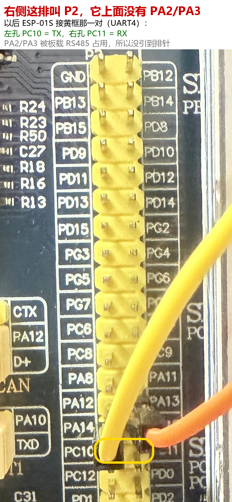

# 硬件与接线

## 1. 物料清单

| 类别 | 型号 | 说明 |
|---|---|---|
| 主控 | 正点原子 精英 STM32F103ZET6 | 72 MHz，512 KB Flash / 64 KB RAM |
| 屏 | 正点原子 2.8 寸 TFT，FSMC 并口 | 上电读到 LCD ID = 0x7789 |
| Wi-Fi | ESP-01S | 出厂 AT 固件，3.3 V，发射峰值电流约 300 mA |
| 温度 | DS18B20 | 单总线，12 位，分辨率 0.0625 ℃ |
| 六轴 | MPU6050 模块 | I2C 地址 0x68，本项目只用加速度 |
| USB 转串口 | CH340 ×2 | 一路调试，一路接 Modbus 从站 |
| 电源 | 3.3 V 独立电源 | 给 ESP-01S 用，必须与开发板共地 |

## 2. 引脚分配

| 功能 | 引脚 | 外设 | 参数 |
|---|---|---|---|
| 调试打印 | PA9 / PA10 | USART1 | 115200 8N1 |
| Modbus RTU | PB10 / PB11 | USART3 | 9600 8N1，接 USB-TTL |
| ESP-01S | PC10 / PC11 | UART4 | 115200 8N1，PC10=TX 接模块 RX |
| DS18B20 | PA1 | 普通 GPIO | DQ 线，需要上拉 |
| MPU6050 | PB6 / PB7 | 软件 I2C | SCL / SDA，约 125 kHz |
| LED0 | PB5 | GPIO 输出 | 低电平点亮，心跳灯 |
| LED1 | PE5 | GPIO 输出 | 低电平点亮，报警灯 |
| KEY1 | PE3 | GPIO 输入 | 按下计数 |
| CAN | PA11 / PA12 | bxCAN | 500 kbps，PA11=RX、PA12=TX，外接 TJA1050（5V 供电）；目前仅做单节点回环自测，未接真实 CAN 总线 |
| LCD | FSMC | 并口 8080 | 原厂排线，不做改动 |

PC10 / PC11 在开发板 P2 排针上的位置：



## 3. 接线注意

1. **ESP-01S 必须和开发板共地**，否则 AT 指令时好时坏，串口上表现为 `esp[0] 0 bytes`。
2. ESP-01S 的 EN 脚要接 3.3 V，否则模块不进入工作状态，同样表现为无响应。
3. ESP-01S 只用开发板 3.3 V 供电时，发射瞬间掉压会重启；建议单独 3.3 V 电源。
4. DS18B20 裸管需要 4.7 kΩ 上拉到 3.3 V；带小板模块一般已焊好。
5. Modbus 那路 USB-TTL 只接 PB10 / PB11 / GND，**不要**再把它的 3.3 V 接到开发板，
   两路电源会打架（实测会导致串口时断时连）。
6. 调试口和 Modbus 口必须是两个不同的 COM 口；插拔前先关闭串口助手，否则占用会失败。

## 4. 上电自检

复位后在调试串口（USART1，115200）应看到：

```text
LCD ID:7789
ds18b20 found
crc selfcheck=CB05 (expect CB05)
i2c scan: 2 found -> 0x50 0x68
mpu id=0x70
```

| 打印 | 含义 | 不正常时的排查方向 |
|---|---|---|
| `LCD ID:7789` | 屏识别成功 | 排线是否插紧、FSMC 配置 |
| `ds18b20 found` | 单总线应答正常 | 上拉电阻、DQ 是否接 PA1、供电 |
| `crc selfcheck=CB05` | Modbus CRC16 算法自检通过 | 算法代码被改动 |
| `i2c scan: 2 found -> 0x50 0x68` | 0x50 为板载 EEPROM，0x68 为 MPU6050 | SDA/SCL 是否接反、是否上拉 |
| `mpu id=0x70` | MPU6050 的 WHO_AM_I 寄存器 | 供电、模块地址 |

如果 `ds18b20 found` 偶尔不出现，属于单总线时序受干扰，程序会自动保留上一次有效温度，不影响其他功能。